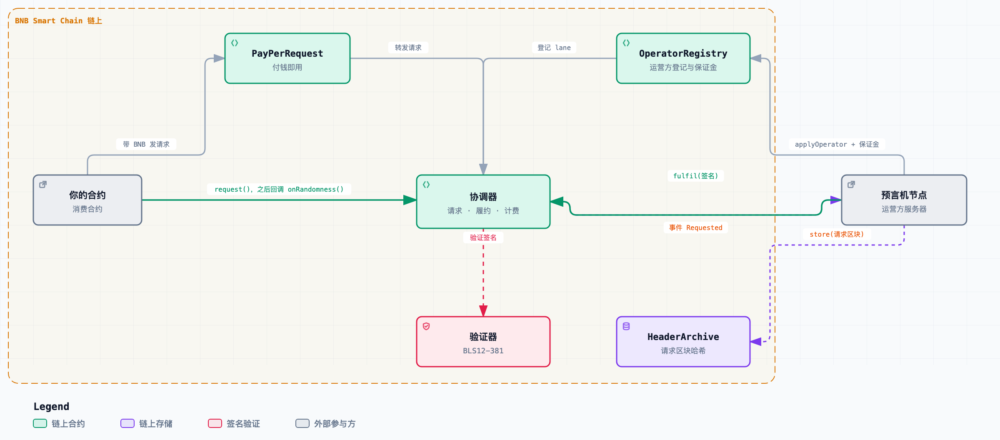
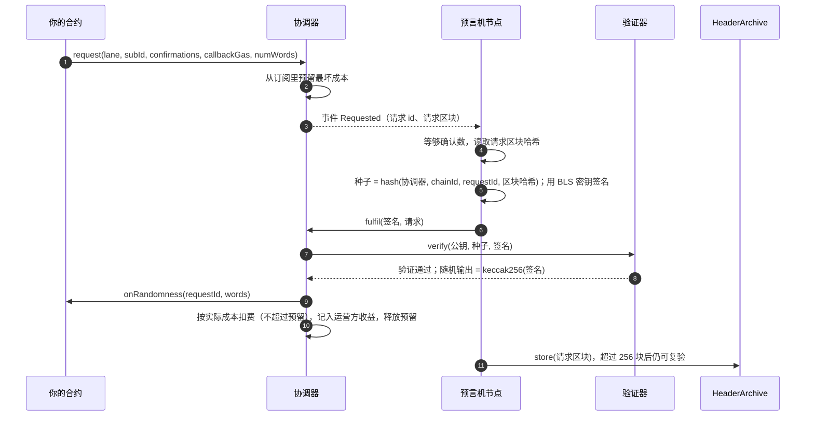
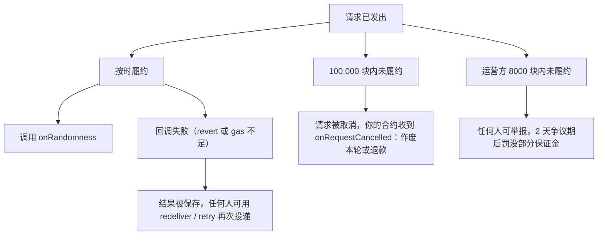
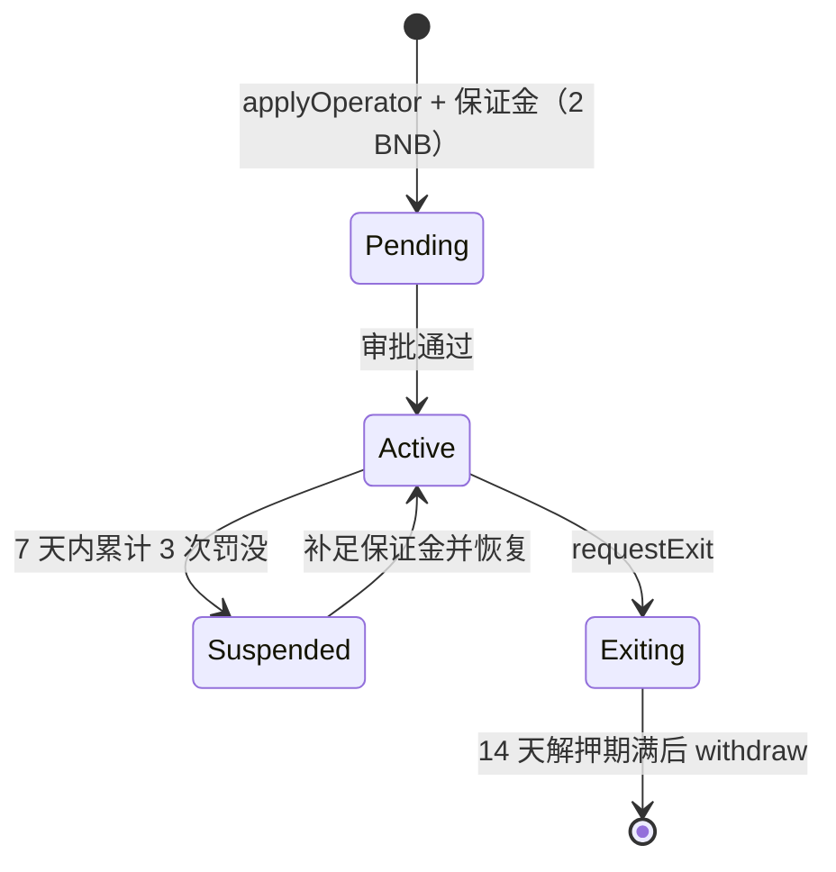

# 链上可验证随机数（VRF）接入指南

[English](README.md) | **简体中文** | [繁體中文](README.zh-TW.md)

BSC 主网上的可验证随机数服务。你的合约发起请求，预言机用 BLS12-381 唯一签名生成随机数并在链上验证后回调你的合约。随机数种子包含请求区块的哈希，请求发出时没有人能预知结果；任何人可以事后复验。

- 网络：**BNB Smart Chain 主网（chainId 56）**
- 支付：原生 **BNB**
- 接入方式：**订阅制**（预付、按实际成本扣费）或 **付钱即用**（每次请求附带 BNB）

## 目录

0. [工作原理](#how)
   - [0.1 请求全流程](#how-lifecycle)
   - [0.2 出问题时会怎样](#how-fail)
1. [合约地址](#addresses)
2. [参数与限制](#params)
3. [快速接入](#quickstart)
   - [3.1 先定义接口](#interfaces)
   - [3.2 方式一：订阅制](#subscription)
   - [3.3 方式二：付钱即用](#payperrequest)
4. [费用](#fees)
5. [回调规则与安全用法](#rules)
6. [事后复验](#verify)
7. [常见错误](#errors)
8. [运营方入驻指南（运行预言机节点）](#operators)
   - [8.1 概览与准入](#op-overview)
   - [8.2 准备清单](#op-prepare)
   - [8.3 获取并校验节点程序](#op-download)
   - [8.4 生成密钥并申请入驻](#op-register)
   - [8.5 配置并运行节点](#op-run)
   - [8.6 监控与告警](#op-monitor)
   - [8.7 日常运维](#op-ops)
   - [8.8 收益与提取](#op-earn)
   - [8.9 义务与罚没](#op-slash)
   - [8.10 退出](#op-exit)
9. [限制](#limits)
10. [许可](#license)

<a id="how"></a>
## 工作原理

你的合约请求一个随机数。预言机对一个包含请求区块哈希的种子签名；链上验证签名，由签名派生出随机数，再回调你的合约。一个种子只有唯一合法的签名，所以预言机无法挑选结果，任何人事后都能复核。

<p align="center">
  <picture>
    <source media="(prefers-color-scheme: dark)" srcset="images/vrf-overview-zh-CN-dark.png">
    
  </picture>
</p>

<a id="how-lifecycle"></a>
### 0.1 请求全流程



<a id="how-fail"></a>
### 0.2 出问题时会怎样



<a id="addresses"></a>
## 1. 合约地址（BSC 主网，chainId 56）

| 合约 | 地址 | 用途 |
|---|---|---|
| Coordinator（协调器） | `0x481044B907C40A8eF406691168064BCe8B3fb836` | 订阅、请求、履约、验证 |
| PayPerRequest | `0x72AA07A2c1852F6EdB1Ee068ca1Af74444A8A5Ac` | 付钱即用入口 |
| Reader | `0x2F7d603EA5Fac589701177f2D570F0417F37bf30` | 查询余额 / 报价 / 复验随机数 |
| HeaderArchive | `0x3366b0cBBf31DBCf4dC1EC4dc87F844a4490A4d6` | 请求区块哈希存档（用于事后复验） |
| OperatorRegistry | `0x01DA9bfe6b614f9497c97efE3C90Dfb172fB45Ca` | 运营方登记 |
| Verifier | `0x46F8c7579B6A299750341237bAaeA6fFbf7A2334` | BLS 签名验证 |

**官方 lane：** `0xfe6f6c68fa6c50e1569c6fe61d9637af93d04632c000c835d41464b41efef2d0`

lane 是一个预言机密钥的标识（公钥的 `keccak256`）。发请求时必须指定 lane。协调器与 PayPerRequest 均为可升级代理合约，**请始终使用上表的代理地址**。

<a id="params"></a>
## 2. 参数与限制

| 项目 | 值 |
|---|---|
| 最少确认数 | 3（可填更大，最大 200） |
| 单次请求随机数个数 | 最多 500 |
| 每个订阅的消费合约数 | 最多 100 |
| 回调 gas 上限 | 2,500,000 |
| 请求超时（未履约则取消） | 100,000 块（按当前出块速度约 12.5 小时） |
| 履约批量 | 单笔最多 25 个请求 |

费率见[第 4 节](#fees)。

<a id="quickstart"></a>
## 3. 快速接入

<a id="interfaces"></a>
### 3.1 先定义接口（无需任何额外依赖）

```solidity
interface IRandomnessCoordinator {
    function createSubscription() external returns (uint256 subId);
    function fundSubscription(uint256 subId) external payable;
    function addConsumer(uint256 subId, address consumer) external;
    function cancelSubscription(uint256 subId, address payable to) external;
    function request(bytes32 lane, uint256 subId, uint16 confirmations, uint32 callbackGas, uint32 numWords)
        external returns (uint256 requestId);
    function quote(bytes32 lane, uint32 callbackGas, uint32 numWords) external view returns (uint256);
}

interface IPayPerRequest {
    function quote(uint32 callbackGas, uint32 numWords) external view returns (uint256);
    function request(uint32 callbackGas, uint32 numWords) external payable returns (uint256 requestId);
}
```

你的合约需要实现两个回调（只允许协调器 / PayPerRequest 调用）：

```solidity
function onRandomness(uint256 requestId, uint256[] calldata words) external;
function onRequestCancelled(uint256 requestId) external; // 可选；请求超时被取消时收到通知
```

<a id="subscription"></a>
### 3.2 方式一：订阅制（请求多、常用）

```solidity
contract MyGame {
    address constant COORDINATOR = 0x481044B907C40A8eF406691168064BCe8B3fb836;
    bytes32 constant LANE = 0xfe6f6c68fa6c50e1569c6fe61d9637af93d04632c000c835d41464b41efef2d0;
    uint256 public subId;
    mapping(uint256 => address) public playerOf;

    // ① 一次性设置：开订阅、充值、登记本合约为消费者（也可以用钱包在外部完成）
    function setup() external payable {
        IRandomnessCoordinator c = IRandomnessCoordinator(COORDINATOR);
        subId = c.createSubscription();
        c.fundSubscription{value: msg.value}(subId);
        c.addConsumer(subId, address(this));
    }

    // ② 发请求：确认数 12，回调 gas 200,000，要 1 个随机数
    function play() external {
        uint256 id = IRandomnessCoordinator(COORDINATOR).request(LANE, subId, 12, 200_000, 1);
        playerOf[id] = msg.sender;
    }

    // ③ 回调：只允许协调器调用
    function onRandomness(uint256 requestId, uint256[] calldata words) external {
        require(msg.sender == COORDINATOR, "only coordinator");
        // 使用 words[0]；不要 revert；不要在这里写大量存储
    }

    function onRequestCancelled(uint256 requestId) external {
        require(msg.sender == COORDINATOR, "only coordinator");
        // 请求超时被取消：作废本轮 / 退款。不要在这里重新请求
    }
}
```

示例为说明流程而简化，省略了权限控制；实际使用请自行为 `setup`、提取余额等函数加上访问控制。

订阅可以由任何地址创建和充值，创建者是订阅持有者。不再使用时，持有者调用 `cancelSubscription` 取回余额（有未履约请求时不可取消）。

<a id="payperrequest"></a>
### 3.3 方式二：付钱即用（偶尔用、不想管订阅）

```solidity
address constant PPR = 0x72AA07A2c1852F6EdB1Ee068ca1Af74444A8A5Ac;

function play() external payable {
    uint256 price = IPayPerRequest(PPR).quote(200_000, 1);   // 回调 gas, 随机数个数
    uint256 id = IPayPerRequest(PPR).request{value: price}(200_000, 1); // 多付的当场退回
}
// 随机数会转发到调用者合约的 onRandomness(requestId, words)
```

回调失败时随机数会被保存，可调用 PayPerRequest 的 `retry(requestId)` 再次投递，不会丢失。

**付钱即用的路径**


<a id="fees"></a>
## 4. 费用

- **订阅制**：发请求时按该 lane 的最高 gas 价**预留**最坏成本（预留不扣钱）；履约时**按实际成本**扣费，不超过预留额，多余的留在订阅里。
  实收 = 实际 gas 成本 × (1 + 溢价) + 固定费
- **付钱即用**：价格 = 协调器报价 × (1 + 加价)；多付的部分当场退回。
- **费率**

| 项目 | 数值 | 说明 |
|---|---|---|
| 溢价 | **10%** | 在实际 gas 成本上加 10% |
| 固定费 | **0.001 BNB** | 每次履约收取一次 |
| 付钱即用加价 | **10%** | 仅付钱即用模式，在协调器报价上再加 10% |

- **链上读取（以链上为准）**：
  - 溢价 `premiumBps`、固定费 `flatFee`：`Coordinator.settings()`
  - 加价 `markupBps`：`PayPerRequest.markupBps()`
- **报价与余额查询**：
  - `Coordinator.quote(lane, callbackGas, numWords)`：发一个请求要预留多少
  - `PayPerRequest.quote(callbackGas, numWords)`：付钱即用的价格（当前 gas 价下）
  - `Reader.affordable(subId, lane, callbackGas, numWords)`：订阅还能发几个
  - `Reader.shortfall(subId, lane, callbackGas, numWords, n)`：发 n 个还差多少 wei

回调 gas 越大、随机数个数越多、当时 gas 价越高，费用越高。

<a id="rules"></a>
## 5. 回调规则与安全用法

1. 回调里**不要 revert**，也不要超过请求时填写的 `callbackGas`，否则会记为回调失败，需要重新投递。
2. 回调里**不要写大量存储**：只存种子或结果摘要，其余在 view 函数里重算。
3. 请求发出后到回调之间，**锁定相关状态**，不要让用户在看到结果之后再决定是否参与。
4. 价值大的抽奖，确认数建议 **≥ 12**（抗链重组）。
5. 请求超时会被取消并通知 `onRequestCancelled`：在里面作废本轮或退款，**不要重新请求**（重新请求等于换种子重摇）。
6. 回调里允许再发新请求（连续抽奖）。

<a id="verify"></a>
## 6. 事后复验

任何人可调用 `Reader.verifyFulfilment(lane, requestId, blockNumber, numWords, sig)` 复算并核对随机数。节点履约后会自动把请求区块哈希存入 HeaderArchive，所以超过 256 块的请求也能复验。

<a id="errors"></a>
## 7. 常见错误

| 现象 | 原因与处理 |
|---|---|
| `Underfunded` | 订阅可用余额小于预留额。充值，或用 `Reader.shortfall` 算差额 |
| `Underpaid` | 付钱即用：`msg.value` 低于报价。先调 `quote` |
| 回调没触发 | 查 `DeliveryFailed` 事件；订阅制可由任何人 `redeliver`，付钱即用调 `retry` |
| 请求迟迟没履约 | 超时（100,000 块）后会被取消，并通知你的 `onRequestCancelled` |
| 回调被拒 | 回调只接受协调器 / PayPerRequest 的调用 |

<a id="operators"></a>
## 8. 运营方入驻指南（运行预言机节点）

<a id="op-overview"></a>
### 8.1 概览与准入

任何团队都可以申请成为运营方，运行自己的预言机节点，赚取服务费分成。你的节点持有一把 BLS 密钥，对每个请求生成唯一签名；协调器在链上验证签名后回调消费合约。**私钥永远不上链、不外传。**

- 准入：提交公钥和持有证明，缴纳保证金，**经审批后生效**。
- 保证金：**最低 2 BNB**，退出时取回（扣除罚没后）。
- 收益：服务费的 **70%**（默认，上限 90%）+ 履约 gas 补偿。

**运营方生命周期**



<a id="op-prepare"></a>
### 8.2 准备清单

| 项目 | 建议 |
|---|---|
| 服务器 | Linux，**1 核 CPU / 1GB 内存 / 10GB 磁盘**即可；需安装 Docker；长期在线 |
| RPC | **至少 2 个不同供应商**，必须支持 `getLogs`（公共节点通常不行）；把 `GETLOGS_RANGE` 设在供应商单次上限之内（常见 5000） |
| BLS 密钥 | 本机生成，加密存放，**永不上链、永不外传** |
| 热钱包 | 另一把**独立**私钥，专用于发履约交易；**起步放 0.1 BNB**，低于 0.01 BNB 就补（履约 gas 会由协议补偿，但要先垫付） |
| 管理地址 | 申请入驻、提取保证金的地址（可以是硬件钱包 / 多签）；与热钱包、BLS 密钥都不同 |
| 保证金 | 2 BNB |

两把密钥（BLS 密钥、热钱包）**必须不同**，节点启动时会检查。

<a id="op-download"></a>
### 8.3 获取并校验节点程序

1. 到本仓库的 [Releases](../../releases) 下载 `vrf-oracle-<版本>.tar.gz` 和 `SHA256SUMS`。
2. 校验完整性（在放着两个文件的目录里）：

```bash
tar xzf vrf-oracle-1.1.0.tar.gz
sha256sum -c SHA256SUMS      # macOS: shasum -a 256 -c SHA256SUMS
```

3. 构建镜像：

```bash
cd vrf-oracle-1.1.0
docker build -t vrf-oracle:1.1.0 .
```

镜像里不含任何密钥；密钥、口令、RPC 地址都在运行时提供。后面的命令都在你放配置的工作目录里执行（例如 `~/vrf`）。

<a id="op-register"></a>
### 8.4 生成密钥并申请入驻

**第 1 步：生成 BLS 密钥**（口令在终端输入，至少 12 位，不回显；私钥只存在加密文件里）

```bash
mkdir -p keys && sudo chown 1000:1000 keys
docker run --rm -it -v "$PWD/keys:/keys" --entrypoint node vrf-oracle:1.1.0 \
  opcli.mjs keygen --keystore /keys/oracle.keystore
```

**第 2 步：保存口令文件和热钱包私钥文件**（用 `read -s` 输入，不进命令历史）

```bash
read -rs -p "keystore 口令: " P; printf '%s' "$P" > ks_password; unset P; echo
read -rs -p "热钱包私钥(0x...): " K; printf '%s' "$K" > tx_key; unset K; echo
sudo chown 1000:1000 ks_password tx_key && sudo chmod 0400 ks_password tx_key
```

**第 3 步：查看公钥和 lane**

```bash
docker run --rm -it -v "$PWD/keys:/keys:ro" --entrypoint node vrf-oracle:1.1.0 \
  opcli.mjs pubkey --keystore /keys/oracle.keystore
```

**第 4 步：生成申请。** 先写一个最小的 `reg.env`：

```
RPC_URLS=https://你的RPC1,https://你的RPC2
COORDINATOR=0x481044B907C40A8eF406691168064BCe8B3fb836
EXPECT_CHAIN_ID=56
```

```bash
docker run --rm -it --env-file reg.env -v "$PWD/keys:/keys:ro" --entrypoint node vrf-oracle:1.1.0 \
  opcli.mjs register --keystore /keys/oracle.keystore \
  --registry 0x01DA9bfe6b614f9497c97efE3C90Dfb172fB45Ca \
  --admin <你的管理地址> --payee <收款地址> --value 2
```

默认**只打印**调用数据（`applyOperator(pk, pop)`，附带 2 BNB），不发送。推荐用你的管理地址的钱包（硬件钱包 / 多签）向 OperatorRegistry 发这笔交易：to = 注册表地址、value = 2 BNB、data = 打印出的调用数据。也可以设 `ADMIN_KEY_FILE` 指向管理地址私钥文件并加 `--send` 由命令行发送（`--admin` 必须与该私钥对应的地址一致）。

**第 5 步：等审批。** 申请提交后状态为 Pending，审批通过后注册表在协调器登记你的 lane。可用体检命令查看状态（见 8.5）。

<a id="op-run"></a>
### 8.5 配置并运行节点

创建 `node.env`：

```
RPC_URLS=https://你的RPC1,https://你的RPC2
COORDINATOR=0x481044B907C40A8eF406691168064BCe8B3fb836
EXPECT_CHAIN_ID=56
EXPECTED_LANE=<第 3 步得到的 lane>
GETLOGS_RANGE=5000
POLL_MS=5000
TX_KEY_FILE=/run/secrets/tx_key
ORACLE_KEYSTORE=/keys/oracle.keystore
ORACLE_KEYSTORE_PASSWORD_FILE=/run/secrets/ks_password
```

**启动前先体检**（有 FAIL 不要启动）：

```bash
docker run --rm -it --env-file node.env \
  -v "$PWD/keys:/keys:ro" -v "$PWD/ks_password:/run/secrets/ks_password:ro" -v "$PWD/tx_key:/run/secrets/tx_key:ro" \
  --entrypoint node vrf-oracle:1.1.0 opcli.mjs doctor
```

体检会检查：RPC 连通、`getLogs` 可用、协调器、热钱包余额、lane 与公钥一致、存档合约、注册表状态（Pending / Active）。**注册表状态为 Active、全部检查通过**后再启动。

**启动节点：**

```bash
docker run -d --name vrf-oracle --restart unless-stopped --env-file node.env \
  -v "$PWD/keys:/keys:ro" \
  -v "$PWD/ks_password:/run/secrets/ks_password:ro" \
  -v "$PWD/tx_key:/run/secrets/tx_key:ro" \
  -v vrf-state:/data \
  --read-only --cap-drop ALL --security-opt no-new-privileges \
  vrf-oracle:1.1.0
```

查看运行状态：

```bash
docker ps --filter name=vrf-oracle        # STATUS 应为 healthy
docker logs --tail 20 vrf-oracle          # 应看到 node up, lane ...
```

节点每处理一个新块就刷新游标文件（在 `vrf-state` 卷里）；重启后从上次位置续扫，不会漏请求。履约后会自动把请求区块哈希存入 HeaderArchive，供事后复验。

<a id="op-monitor"></a>
### 8.6 监控与告警

同一个镜像自带只读监控程序（无密钥）。创建 `monitor.env`：

```
RPC_URLS=https://你的RPC1,https://你的RPC2
COORDINATOR=0x481044B907C40A8eF406691168064BCe8B3fb836
REGISTRY=0x01DA9bfe6b614f9497c97efE3C90Dfb172fB45Ca
LANES=<你的 lane>
NODE_WALLET=<热钱包地址>
NODE_MIN_BALANCE_WEI=10000000000000000
PENDING_ALERT_BLOCKS=400
GETLOGS_RANGE=5000
POLL_MS=60000
MONITOR_NAME=my-oracle
ALERT_WEBHOOK=
```

```bash
docker run -d --name vrf-monitor --restart unless-stopped --env-file monitor.env \
  -v vrf-monitor-state:/data -e STATE_FILE=/data/vrf-monitor-state.json \
  --read-only --cap-drop ALL --entrypoint node vrf-oracle:1.1.0 monitor.mjs
```

它会在以下情况告警：热钱包余额低于 `NODE_MIN_BALANCE_WEI`（0.01 BNB）、请求挂起超过 `PENDING_ALERT_BLOCKS` 块没履约、lane 被停用或合约状态异常。告警写入日志（`docker logs vrf-monitor`，`level=alert` 的行需要处理）；设置 `ALERT_WEBHOOK` 后还会以 JSON POST 推送到该地址（字段：`source, name, level, ev, ts, text, detail`，其中 `text` 是一行可读摘要，可接 Telegram / Slack / 企业微信等）。

<a id="op-ops"></a>
### 8.7 日常运维

- **别掉线。** 请求就绪后超过 8000 块（按当前出块速度约 1 小时）仍未履约会被举报罚没（见 [8.9](#op-slash)）。节点用 `--restart unless-stopped` 常驻；升级、迁移时把停机控制在 10 分钟以内。
- **升级节点：**
  1. 下载新版本，校验 `SHA256SUMS`，`docker build -t vrf-oracle:<新版本> .`
  2. `docker stop vrf-oracle && docker rm vrf-oracle`
  3. 用同样的参数和**同一个 `vrf-state` 卷**启动新镜像，游标会接着用。
- **热钱包余额。** 低于 0.01 BNB 就补，不要等到发不出交易。
- **RPC。** 至少两个供应商；注意免费额度（轮询间隔 3000~5000 毫秒足够，间隔太短会很快耗光额度）。
- **备份。** `keys/oracle.keystore` 和口令文件要离线备份；**丢失 BLS 密钥 = 该 lane 无法继续服务**，需要重新生成密钥并重新申请。
- **更换热钱包。** 更新 `tx_key` 文件后重建容器即可，不影响 lane。

<a id="op-earn"></a>
### 8.8 收益与提取

- 每次履约：`服务费 = 实收 − gas 补偿`，运营方分成 = 服务费 × 分成比例（默认 70%）。分成记入你的**收款地址**的 `credits`；履约 gas 补偿记给**提交履约交易的地址**（热钱包）。
- 提取：对应地址调用 `Coordinator.claimCredits(to)`。可用该地址的钱包在 BscScan 的 Write Contract 页面操作。
- 分成比例按 lane 配置，变更不追溯。

<a id="op-slash"></a>
### 8.9 义务与罚没

| 项目 | 数值 |
|---|---|
| 最低保证金 | 2 BNB |
| 判定未履约 | 请求就绪后超过 8000 块（按当前出块速度约 1 小时）仍未履约，任何人可举报 |
| 每次罚没 | 0.1 BNB |
| 同一运营方两次计罚的最短间隔 | 1 小时（同一事故只罚一次） |
| 罚没累计上限 | 7 天滑动窗口内不超过保证金的 20% |
| 争议期 | 2 天（仲裁方可否决；到期后任何人可执行罚没） |
| 自动挂起 | 7 天内累计 3 次罚没 |
| 解押期 | 14 天（申请退出时起算，之后可 `withdraw`） |
| lane 最高 gas 价 | 范围 0.1 ~ 2 gwei，新 lane 默认 1 gwei |

- 罚没款不归协议方，转入销毁地址。
- 只罚"区块哈希可得"的请求（最近 256 块，或已存档）；节点离线过久导致无法履约的请求不罚运营方。
- 被挂起后补足保证金（`topUp(id)`），由审批方恢复。
- 以上数值以链上 `OperatorRegistry.params()` 为准。

<a id="op-exit"></a>
### 8.10 退出

1. 用管理地址调用 `OperatorRegistry.requestExit(id)`（`id` 可通过 `opOfLane(lane)` 查到）。此后不再接新请求。
2. 等待解押期（14 天）。期间保证金仍可能被未决罚没扣减。
3. 解押期满，调用 `OperatorRegistry.withdraw(id, to)` 取回保证金。
4. 退出前先让节点把在途请求履约完，再停止节点。

<a id="limits"></a>
## 9. 限制

- 仅 BNB Smart Chain 主网；仅用 BNB 支付。
- 接口与 Chainlink 不兼容，已有 Chainlink 合约需按上面的接口改写。
- 单个运营方可以拒绝履约；请求超时会被取消并通知你，不会静默失败。对不能承受随机数延迟的业务，不要只依赖单个 lane。

<a id="license"></a>
## 10. 许可

本仓库的文档和节点程序（Releases 中的 `vrf-oracle-<版本>.tar.gz`）采用 **MIT 许可**，版权所有 © 2026 clkhoo5211，完整条款见仓库根目录的 [LICENSE](LICENSE)。

- 你可以自由使用、修改、商用和再分发，只需保留版权声明和许可声明。
- 软件和文档按"原样"提供，不附带任何明示或暗示的担保；使用本服务和本程序的风险由使用者自行承担。
- 节点程序依赖的第三方库（`ethers`、`@noble/curves`）各自遵循其 MIT 许可。
- 本文档所列合约地址为 BNB Smart Chain 主网上的公开信息。
