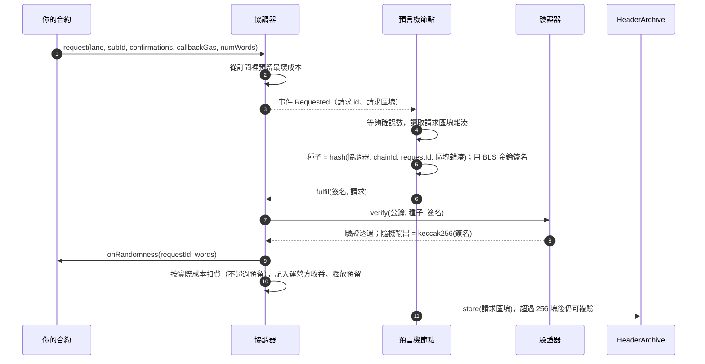
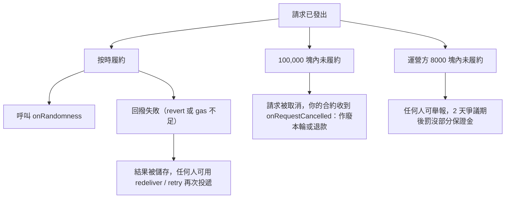
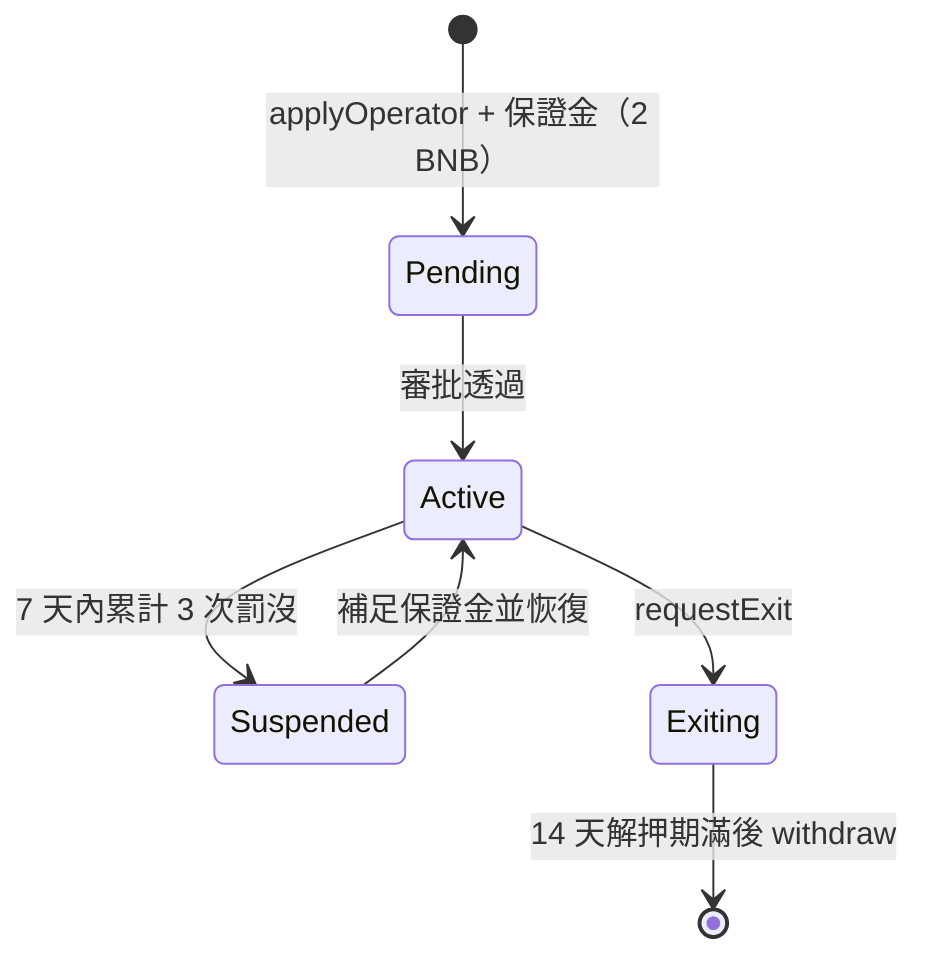

# 鏈上可驗證隨機數（VRF）接入指南

[English](README.md) | [简体中文](README.zh-CN.md) | **繁體中文**

BSC 主網上的可驗證隨機數服務。你的合約發起請求，預言機用 BLS12-381 唯一簽名生成隨機數並在鏈上驗證後回撥你的合約。隨機數種子包含請求區塊的雜湊，請求發出時沒有人能預知結果；任何人可以事後複驗。

- 網路：**BNB Smart Chain 主網（chainId 56）**
- 支付：原生 **BNB**
- 接入方式：**訂閱制**（預付、按實際成本扣費）或 **付錢即用**（每次請求附帶 BNB）

## 目錄

0. [工作原理](#how)
   - [0.1 請求全流程](#how-lifecycle)
   - [0.2 出問題時會怎樣](#how-fail)
1. [合約地址](#addresses)
2. [參數與限制](#params)
3. [快速接入](#quickstart)
   - [3.1 先定義介面](#interfaces)
   - [3.2 方式一：訂閱制](#subscription)
   - [3.3 方式二：付錢即用](#payperrequest)
4. [費用](#fees)
5. [回撥規則與安全用法](#rules)
6. [事後複驗](#verify)
7. [常見錯誤](#errors)
8. [運營方入駐指南（執行預言機節點）](#operators)
   - [8.1 概覽與准入](#op-overview)
   - [8.2 準備清單](#op-prepare)
   - [8.3 獲取並校驗節點程式](#op-download)
   - [8.4 生成金鑰並申請入駐](#op-register)
   - [8.5 配置並執行節點](#op-run)
   - [8.6 監控與告警](#op-monitor)
   - [8.7 日常運維](#op-ops)
   - [8.8 收益與提取](#op-earn)
   - [8.9 義務與罰沒](#op-slash)
   - [8.10 退出](#op-exit)
9. [限制](#limits)
10. [許可](#license)

<a id="how"></a>
## 工作原理

你的合約請求一個隨機數。預言機對一個包含請求區塊雜湊的種子簽名；鏈上驗證簽名，由簽名派生出隨機數，再回撥你的合約。一個種子只有唯一合法的簽名，所以預言機無法挑選結果，任何人事後都能複核。

<a id="how-lifecycle"></a>
### 0.1 請求全流程



<a id="how-fail"></a>
### 0.2 出問題時會怎樣



<a id="addresses"></a>
## 1. 合約地址（BSC 主網，chainId 56）

| 合約 | 地址 | 用途 |
|---|---|---|
| Coordinator（協調器） | `0x481044B907C40A8eF406691168064BCe8B3fb836` | 訂閱、請求、履約、驗證 |
| PayPerRequest | `0x72AA07A2c1852F6EdB1Ee068ca1Af74444A8A5Ac` | 付錢即用入口 |
| Reader | `0x2F7d603EA5Fac589701177f2D570F0417F37bf30` | 查詢餘額 / 報價 / 複驗隨機數 |
| HeaderArchive | `0x3366b0cBBf31DBCf4dC1EC4dc87F844a4490A4d6` | 請求區塊雜湊存檔（用於事後複驗） |
| OperatorRegistry | `0x01DA9bfe6b614f9497c97efE3C90Dfb172fB45Ca` | 運營方登記 |
| Verifier | `0x46F8c7579B6A299750341237bAaeA6fFbf7A2334` | BLS 簽名驗證 |

**官方 lane：** `0xfe6f6c68fa6c50e1569c6fe61d9637af93d04632c000c835d41464b41efef2d0`

lane 是一個預言機金鑰的標識（公鑰的 `keccak256`）。發請求時必須指定 lane。協調器與 PayPerRequest 均為可升級代理合約，**請始終使用上表的代理地址**。

<a id="params"></a>
## 2. 參數與限制

| 專案 | 值 |
|---|---|
| 最少確認數 | 3（可填更大，最大 200） |
| 單次請求隨機數個數 | 最多 500 |
| 每個訂閱的消費合約數 | 最多 100 |
| 回撥 gas 上限 | 2,500,000 |
| 請求超時（未履約則取消） | 100,000 塊（按當前出塊速度約 12.5 小時） |
| 履約批次 | 單筆最多 25 個請求 |

費率見[第 4 節](#fees)。

<a id="quickstart"></a>
## 3. 快速接入

<a id="interfaces"></a>
### 3.1 先定義介面（無需任何額外依賴）

```solidity
interface IRandomnessCoordinator {
    function createSubscription() external returns (uint256 subId);
    function fundSubscription(uint256 subId) external payable;
    function addConsumer(uint256 subId, address consumer) external;
    function cancelSubscription(uint256 subId, address payable to) external;
    function request(bytes32 lane, uint256 subId, uint16 confirmations, uint32 callbackGas, uint32 numWords)
        external returns (uint256 requestId);
    function quote(bytes32 lane, uint32 callbackGas, uint32 numWords) external view returns (uint256);
}

interface IPayPerRequest {
    function quote(uint32 callbackGas, uint32 numWords) external view returns (uint256);
    function request(uint32 callbackGas, uint32 numWords) external payable returns (uint256 requestId);
}
```

你的合約需要實現兩個回撥（只允許協調器 / PayPerRequest 呼叫）：

```solidity
function onRandomness(uint256 requestId, uint256[] calldata words) external;
function onRequestCancelled(uint256 requestId) external; // 可選；請求超時被取消時收到通知
```

<a id="subscription"></a>
### 3.2 方式一：訂閱制（請求多、常用）

```solidity
contract MyGame {
    address constant COORDINATOR = 0x481044B907C40A8eF406691168064BCe8B3fb836;
    bytes32 constant LANE = 0xfe6f6c68fa6c50e1569c6fe61d9637af93d04632c000c835d41464b41efef2d0;
    uint256 public subId;
    mapping(uint256 => address) public playerOf;

    // ① 一次性設定：開訂閱、充值、登記本合約為消費者（也可以用錢包在外部完成）
    function setup() external payable {
        IRandomnessCoordinator c = IRandomnessCoordinator(COORDINATOR);
        subId = c.createSubscription();
        c.fundSubscription{value: msg.value}(subId);
        c.addConsumer(subId, address(this));
    }

    // ② 發請求：確認數 12，回撥 gas 200,000，要 1 個隨機數
    function play() external {
        uint256 id = IRandomnessCoordinator(COORDINATOR).request(LANE, subId, 12, 200_000, 1);
        playerOf[id] = msg.sender;
    }

    // ③ 回撥：只允許協調器呼叫
    function onRandomness(uint256 requestId, uint256[] calldata words) external {
        require(msg.sender == COORDINATOR, "only coordinator");
        // 使用 words[0]；不要 revert；不要在這裡寫大量儲存
    }

    function onRequestCancelled(uint256 requestId) external {
        require(msg.sender == COORDINATOR, "only coordinator");
        // 請求超時被取消：作廢本輪 / 退款。不要在這裡重新請求
    }
}
```

示例為說明流程而簡化，省略了許可權控制；實際使用請自行為 `setup`、提取餘額等函式加上訪問控制。

訂閱可以由任何地址建立和充值，建立者是訂閱持有者。不再使用時，持有者呼叫 `cancelSubscription` 取回餘額（有未履約請求時不可取消）。

<a id="payperrequest"></a>
### 3.3 方式二：付錢即用（偶爾用、不想管訂閱）

```solidity
address constant PPR = 0x72AA07A2c1852F6EdB1Ee068ca1Af74444A8A5Ac;

function play() external payable {
    uint256 price = IPayPerRequest(PPR).quote(200_000, 1);   // 回撥 gas, 隨機數個數
    uint256 id = IPayPerRequest(PPR).request{value: price}(200_000, 1); // 多付的當場退回
}
// 隨機數會轉發到呼叫者合約的 onRandomness(requestId, words)
```

回撥失敗時隨機數會被儲存，可呼叫 PayPerRequest 的 `retry(requestId)` 再次投遞，不會丟失。

**付錢即用的路徑**


<a id="fees"></a>
## 4. 費用

- **訂閱制**：發請求時按該 lane 的最高 gas 價**預留**最壞成本（預留不扣錢）；履約時**按實際成本**扣費，不超過預留額，多餘的留在訂閱裡。
  實收 = 實際 gas 成本 × (1 + 溢價) + 固定費
- **付錢即用**：價格 = 協調器報價 × (1 + 加價)；多付的部分當場退回。
- **費率**

| 專案 | 數值 | 說明 |
|---|---|---|
| 溢價 | **10%** | 在實際 gas 成本上加 10% |
| 固定費 | **0.001 BNB** | 每次履約收取一次 |
| 付錢即用加價 | **10%** | 僅付錢即用模式，在協調器報價上再加 10% |

- **鏈上讀取（以鏈上為準）**：
  - 溢價 `premiumBps`、固定費 `flatFee`：`Coordinator.settings()`
  - 加價 `markupBps`：`PayPerRequest.markupBps()`
- **報價與餘額查詢**：
  - `Coordinator.quote(lane, callbackGas, numWords)`：發一個請求要預留多少
  - `PayPerRequest.quote(callbackGas, numWords)`：付錢即用的價格（當前 gas 價下）
  - `Reader.affordable(subId, lane, callbackGas, numWords)`：訂閱還能發幾個
  - `Reader.shortfall(subId, lane, callbackGas, numWords, n)`：發 n 個還差多少 wei

回撥 gas 越大、隨機數個數越多、當時 gas 價越高，費用越高。

<a id="rules"></a>
## 5. 回撥規則與安全用法

1. 回撥裡**不要 revert**，也不要超過請求時填寫的 `callbackGas`，否則會記為回撥失敗，需要重新投遞。
2. 回撥裡**不要寫大量儲存**：只存種子或結果摘要，其餘在 view 函式里重算。
3. 請求發出後到回撥之間，**鎖定相關狀態**，不要讓使用者在看到結果之後再決定是否參與。
4. 價值大的抽獎，確認數建議 **≥ 12**（抗鏈重組）。
5. 請求超時會被取消並通知 `onRequestCancelled`：在裡面作廢本輪或退款，**不要重新請求**（重新請求等於換種子重搖）。
6. 回撥裡允許再發新請求（連續抽獎）。

<a id="verify"></a>
## 6. 事後複驗

任何人可呼叫 `Reader.verifyFulfilment(lane, requestId, blockNumber, numWords, sig)` 復算並核對隨機數。節點履約後會自動把請求區塊雜湊存入 HeaderArchive，所以超過 256 塊的請求也能複驗。

<a id="errors"></a>
## 7. 常見錯誤

| 現象 | 原因與處理 |
|---|---|
| `Underfunded` | 訂閱可用餘額小於預留額。充值，或用 `Reader.shortfall` 算差額 |
| `Underpaid` | 付錢即用：`msg.value` 低於報價。先調 `quote` |
| 回撥沒觸發 | 查 `DeliveryFailed` 事件；訂閱制可由任何人 `redeliver`，付錢即用調 `retry` |
| 請求遲遲沒履約 | 超時（100,000 塊）後會被取消，並通知你的 `onRequestCancelled` |
| 回撥被拒 | 回撥只接受協調器 / PayPerRequest 的呼叫 |

<a id="operators"></a>
## 8. 運營方入駐指南（執行預言機節點）

<a id="op-overview"></a>
### 8.1 概覽與准入

任何團隊都可以申請成為運營方，執行自己的預言機節點，賺取服務費分成。你的節點持有一把 BLS 金鑰，對每個請求生成唯一簽名；協調器在鏈上驗證簽名後回撥消費合約。**私鑰永遠不上鍊、不外傳。**

- 准入：提交公鑰和持有證明，繳納保證金，**經審批後生效**。
- 保證金：**最低 2 BNB**，退出時取回（扣除罰沒後）。
- 收益：服務費的 **70%**（預設，上限 90%）+ 履約 gas 補償。

**運營方生命週期**



<a id="op-prepare"></a>
### 8.2 準備清單

| 專案 | 建議 |
|---|---|
| 伺服器 | Linux，**1 核 CPU / 1GB 記憶體 / 10GB 磁碟**即可；需安裝 Docker；長期線上 |
| RPC | **至少 2 個不同供應商**，必須支援 `getLogs`（公共節點通常不行）；把 `GETLOGS_RANGE` 設在供應商單次上限之內（常見 5000） |
| BLS 金鑰 | 本機生成，加密存放，**永不上鍊、永不外傳** |
| 熱錢包 | 另一把**獨立**私鑰，專用於發履約交易；**起步放 0.1 BNB**，低於 0.01 BNB 就補（履約 gas 會由協議補償，但要先墊付） |
| 管理地址 | 申請入駐、提取保證金的地址（可以是硬體錢包 / 多籤）；與熱錢包、BLS 金鑰都不同 |
| 保證金 | 2 BNB |

兩把金鑰（BLS 金鑰、熱錢包）**必須不同**，節點啟動時會檢查。

<a id="op-download"></a>
### 8.3 獲取並校驗節點程式

1. 到本倉庫的 [Releases](../../releases) 下載 `vrf-oracle-<版本>.tar.gz` 和 `SHA256SUMS`。
2. 校驗完整性（在放著兩個檔案的目錄裡）：

```bash
tar xzf vrf-oracle-1.1.0.tar.gz
sha256sum -c SHA256SUMS      # macOS: shasum -a 256 -c SHA256SUMS
```

3. 構建映象：

```bash
cd vrf-oracle-1.1.0
docker build -t vrf-oracle:1.1.0 .
```

映象裡不含任何金鑰；金鑰、口令、RPC 地址都在執行時提供。後面的命令都在你放配置的工作目錄裡執行（例如 `~/vrf`）。

<a id="op-register"></a>
### 8.4 生成金鑰並申請入駐

**第 1 步：生成 BLS 金鑰**（口令在終端輸入，至少 12 位，不回顯；私鑰只存在加密檔案裡）

```bash
mkdir -p keys && sudo chown 1000:1000 keys
docker run --rm -it -v "$PWD/keys:/keys" --entrypoint node vrf-oracle:1.1.0 \
  opcli.mjs keygen --keystore /keys/oracle.keystore
```

**第 2 步：儲存口令檔案和熱錢包私鑰檔案**（用 `read -s` 輸入，不進命令歷史）

```bash
read -rs -p "keystore 口令: " P; printf '%s' "$P" > ks_password; unset P; echo
read -rs -p "熱錢包私鑰(0x...): " K; printf '%s' "$K" > tx_key; unset K; echo
sudo chown 1000:1000 ks_password tx_key && sudo chmod 0400 ks_password tx_key
```

**第 3 步：檢視公鑰和 lane**

```bash
docker run --rm -it -v "$PWD/keys:/keys:ro" --entrypoint node vrf-oracle:1.1.0 \
  opcli.mjs pubkey --keystore /keys/oracle.keystore
```

**第 4 步：生成申請。** 先寫一個最小的 `reg.env`：

```
RPC_URLS=https://你的RPC1,https://你的RPC2
COORDINATOR=0x481044B907C40A8eF406691168064BCe8B3fb836
EXPECT_CHAIN_ID=56
```

```bash
docker run --rm -it --env-file reg.env -v "$PWD/keys:/keys:ro" --entrypoint node vrf-oracle:1.1.0 \
  opcli.mjs register --keystore /keys/oracle.keystore \
  --registry 0x01DA9bfe6b614f9497c97efE3C90Dfb172fB45Ca \
  --admin <你的管理地址> --payee <收款地址> --value 2
```

預設**只列印**呼叫資料（`applyOperator(pk, pop)`，附帶 2 BNB），不傳送。推薦用你的管理地址的錢包（硬體錢包 / 多籤）向 OperatorRegistry 發這筆交易：to = 登錄檔地址、value = 2 BNB、data = 列印出的呼叫資料。也可以設 `ADMIN_KEY_FILE` 指向管理地址私鑰檔案並加 `--send` 由命令列傳送（`--admin` 必須與該私鑰對應的地址一致）。

**第 5 步：等審批。** 申請提交後狀態為 Pending，審批透過後登錄檔在協調器登記你的 lane。可用體檢命令檢視狀態（見 8.5）。

<a id="op-run"></a>
### 8.5 配置並執行節點

建立 `node.env`：

```
RPC_URLS=https://你的RPC1,https://你的RPC2
COORDINATOR=0x481044B907C40A8eF406691168064BCe8B3fb836
EXPECT_CHAIN_ID=56
EXPECTED_LANE=<第 3 步得到的 lane>
GETLOGS_RANGE=5000
POLL_MS=5000
TX_KEY_FILE=/run/secrets/tx_key
ORACLE_KEYSTORE=/keys/oracle.keystore
ORACLE_KEYSTORE_PASSWORD_FILE=/run/secrets/ks_password
```

**啟動前先體檢**（有 FAIL 不要啟動）：

```bash
docker run --rm -it --env-file node.env \
  -v "$PWD/keys:/keys:ro" -v "$PWD/ks_password:/run/secrets/ks_password:ro" -v "$PWD/tx_key:/run/secrets/tx_key:ro" \
  --entrypoint node vrf-oracle:1.1.0 opcli.mjs doctor
```

體檢會檢查：RPC 連通、`getLogs` 可用、協調器、熱錢包餘額、lane 與公鑰一致、存檔合約、登錄檔狀態（Pending / Active）。**登錄檔狀態為 Active、全部檢查透過**後再啟動。

**啟動節點：**

```bash
docker run -d --name vrf-oracle --restart unless-stopped --env-file node.env \
  -v "$PWD/keys:/keys:ro" \
  -v "$PWD/ks_password:/run/secrets/ks_password:ro" \
  -v "$PWD/tx_key:/run/secrets/tx_key:ro" \
  -v vrf-state:/data \
  --read-only --cap-drop ALL --security-opt no-new-privileges \
  vrf-oracle:1.1.0
```

檢視執行狀態：

```bash
docker ps --filter name=vrf-oracle        # STATUS 應為 healthy
docker logs --tail 20 vrf-oracle          # 應看到 node up, lane ...
```

節點每處理一個新塊就重新整理遊標檔案（在 `vrf-state` 卷裡）；重啟後從上次位置續掃，不會漏請求。履約後會自動把請求區塊雜湊存入 HeaderArchive，供事後複驗。

<a id="op-monitor"></a>
### 8.6 監控與告警

同一個映象自帶只讀監控程式（無金鑰）。建立 `monitor.env`：

```
RPC_URLS=https://你的RPC1,https://你的RPC2
COORDINATOR=0x481044B907C40A8eF406691168064BCe8B3fb836
REGISTRY=0x01DA9bfe6b614f9497c97efE3C90Dfb172fB45Ca
LANES=<你的 lane>
NODE_WALLET=<熱錢包地址>
NODE_MIN_BALANCE_WEI=10000000000000000
PENDING_ALERT_BLOCKS=400
GETLOGS_RANGE=5000
POLL_MS=60000
MONITOR_NAME=my-oracle
ALERT_WEBHOOK=
```

```bash
docker run -d --name vrf-monitor --restart unless-stopped --env-file monitor.env \
  -v vrf-monitor-state:/data -e STATE_FILE=/data/vrf-monitor-state.json \
  --read-only --cap-drop ALL --entrypoint node vrf-oracle:1.1.0 monitor.mjs
```

它會在以下情況告警：熱錢包餘額低於 `NODE_MIN_BALANCE_WEI`（0.01 BNB）、請求掛起超過 `PENDING_ALERT_BLOCKS` 塊沒履約、lane 被停用或合約狀態異常。告警寫入日誌（`docker logs vrf-monitor`，`level=alert` 的行需要處理）；設定 `ALERT_WEBHOOK` 後還會以 JSON POST 推送到該地址（欄位：`source, name, level, ev, ts, text, detail`，其中 `text` 是一行可讀摘要，可接 Telegram / Slack / 企業微信等）。

<a id="op-ops"></a>
### 8.7 日常運維

- **別掉線。** 請求就緒後超過 8000 塊（按當前出塊速度約 1 小時）仍未履約會被舉報罰沒（見 [8.9](#op-slash)）。節點用 `--restart unless-stopped` 常駐；升級、遷移時把停機控制在 10 分鐘以內。
- **升級節點：**
  1. 下載新版本，校驗 `SHA256SUMS`，`docker build -t vrf-oracle:<新版本> .`
  2. `docker stop vrf-oracle && docker rm vrf-oracle`
  3. 用同樣的參數和**同一個 `vrf-state` 卷**啟動新映象，遊標會接著用。
- **熱錢包餘額。** 低於 0.01 BNB 就補，不要等到發不出交易。
- **RPC。** 至少兩個供應商；注意免費額度（輪詢間隔 3000~5000 毫秒足夠，間隔太短會很快耗光額度）。
- **備份。** `keys/oracle.keystore` 和口令檔案要離線備份；**丟失 BLS 金鑰 = 該 lane 無法繼續服務**，需要重新生成金鑰並重新申請。
- **更換熱錢包。** 更新 `tx_key` 檔案後重建容器即可，不影響 lane。

<a id="op-earn"></a>
### 8.8 收益與提取

- 每次履約：`服務費 = 實收 − gas 補償`，運營方分成 = 服務費 × 分成比例（預設 70%）。分成記入你的**收款地址**的 `credits`；履約 gas 補償記給**提交履約交易的地址**（熱錢包）。
- 提取：對應地址呼叫 `Coordinator.claimCredits(to)`。可用該地址的錢包在 BscScan 的 Write Contract 頁面操作。
- 分成比例按 lane 配置，變更不追溯。

<a id="op-slash"></a>
### 8.9 義務與罰沒

| 專案 | 數值 |
|---|---|
| 最低保證金 | 2 BNB |
| 判定未履約 | 請求就緒後超過 8000 塊（按當前出塊速度約 1 小時）仍未履約，任何人可舉報 |
| 每次罰沒 | 0.1 BNB |
| 同一運營方兩次計罰的最短間隔 | 1 小時（同一事故只罰一次） |
| 罰沒累計上限 | 7 天滑動視窗內不超過保證金的 20% |
| 爭議期 | 2 天（仲裁方可否決；到期後任何人可執行罰沒） |
| 自動掛起 | 7 天內累計 3 次罰沒 |
| 解押期 | 14 天（申請退出時起算，之後可 `withdraw`） |
| lane 最高 gas 價 | 範圍 0.1 ~ 2 gwei，新 lane 預設 1 gwei |

- 罰沒款不歸協議方，轉入銷燬地址。
- 只罰"區塊雜湊可得"的請求（最近 256 塊，或已存檔）；節點離線過久導致無法履約的請求不罰運營方。
- 被掛起後補足保證金（`topUp(id)`），由審批方恢復。
- 以上數值以鏈上 `OperatorRegistry.params()` 為準。

<a id="op-exit"></a>
### 8.10 退出

1. 用管理地址呼叫 `OperatorRegistry.requestExit(id)`（`id` 可透過 `opOfLane(lane)` 查到）。此後不再接新請求。
2. 等待解押期（14 天）。期間保證金仍可能被未決罰沒扣減。
3. 解押期滿，呼叫 `OperatorRegistry.withdraw(id, to)` 取回保證金。
4. 退出前先讓節點把在途請求履約完，再停止節點。

<a id="limits"></a>
## 9. 限制

- 僅 BNB Smart Chain 主網；僅用 BNB 支付。
- 介面與 Chainlink 不相容，已有 Chainlink 合約需按上面的介面改寫。
- 單個運營方可以拒絕履約；請求超時會被取消並通知你，不會靜默失敗。對不能承受隨機數延遲的業務，不要只依賴單個 lane。

<a id="license"></a>
## 10. 許可

本倉庫的文件和節點程式（Releases 中的 `vrf-oracle-<版本>.tar.gz`）採用 **MIT 許可**，版權所有 © 2026 clkhoo5211，完整條款見倉庫根目錄的 [LICENSE](LICENSE)。

- 你可以自由使用、修改、商用和再分發，只需保留版權宣告和許可宣告。
- 軟體和文件按"原樣"提供，不附帶任何明示或暗示的擔保；使用本服務和本程式的風險由使用者自行承擔。
- 節點程式依賴的第三方庫（`ethers`、`@noble/curves`）各自遵循其 MIT 許可。
- 本文件所列合約地址為 BNB Smart Chain 主網上的公開資訊。
